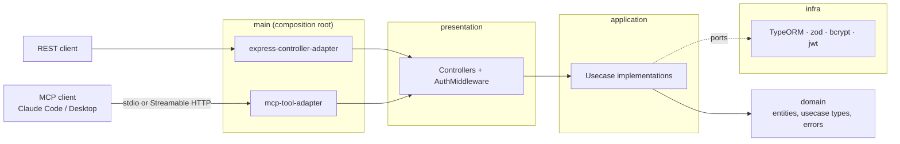

# Over-Engineered CRUD

[](https://github.com/hitaloose/over-engineered-crud/actions/workflows/ci.yml)

A deliberately over-engineered **Auth + Tasks** CRUD in TypeScript, built with Clean Architecture. The point it proves: **the same controllers are served by a REST API and by an MCP server**, so an AI assistant (Claude Code, Claude Desktop, any MCP client) can manage your tasks without one line of business logic changing.

## Architecture



| Layer          | Responsibility                                                                                               |
| -------------- | ------------------------------------------------------------------------------------------------------------ |
| `domain`       | Entities, usecase contracts (`Usecase<Input, Output>`), domain errors. No libraries.                         |
| `application`  | Usecase implementations and the narrow ports they depend on (`TaskFinderByIdRepository`, `HashComparer`, …). |
| `infra`        | TypeORM entities, migrations and repositories, zod schemas, bcrypt, JWT.                                     |
| `presentation` | Framework-agnostic controllers, auth middleware, error-mapping decorator.                                    |
| `main`         | Factories, configs and the **adapters** that plug controllers into Express and MCP.                          |

`src/main/adapters/mcp-tool-adapter.ts` is the twin of `express-controller-adapter.ts`: it turns MCP tool arguments into a `Controller.Request`, runs the same decorated controller, and turns the `Controller.Response` into an MCP `CallToolResult` (`isError` for 4xx/5xx). Tool input schemas are the **same zod schemas** the REST API validates with.

## Features

- Register, login and `GET /auth/me` with bcrypt + JWT
- Tasks CRUD scoped to the authenticated user, with status filter and pagination
- MCP server with 7 tools, over **stdio** (local) and **Streamable HTTP** (`POST /mcp`, same bearer auth as the API)
- Migrations that run on Postgres (dev/prod) and in-memory SQLite (tests)
- Unit tests for every usecase plus HTTP and MCP integration tests
- AI-assisted development setup: `CLAUDE.md`, a project skill, hooks, `.mcp.json`, and Claude PR review in CI

## Getting started

Requires Node.js ≥ 20 and Docker.

```bash
cp .env.example .env        # set JWT_SECRET
npm install
docker compose up -d        # Postgres + API on $API_PORT (migrations run on boot)
```

For local development with reload: `docker compose up app_db -d && npm run dev`.

## REST API

| Method   | Path                            | Auth   | Description                                                 |
| -------- | ------------------------------- | ------ | ----------------------------------------------------------- |
| `GET`    | `/health`                       |        | Liveness check                                              |
| `POST`   | `/auth/register`                |        | `{ name, username, email, password, passwordConfirmation }` |
| `POST`   | `/auth/login`                   |        | `{ email, password }` → `{ user, token }`                   |
| `GET`    | `/auth/me`                      | Bearer | Current user                                                |
| `POST`   | `/tasks`                        | Bearer | `{ title, description?, status?, dueDate? }`                |
| `GET`    | `/tasks?status=&page=&perPage=` | Bearer | Paginated list, newest first                                |
| `GET`    | `/tasks/:taskId`                | Bearer | One task                                                    |
| `PATCH`  | `/tasks/:taskId`                | Bearer | Partial update                                              |
| `DELETE` | `/tasks/:taskId`                | Bearer | Delete (204)                                                |

Errors: `400` validation (with per-field `details`), `401` auth, `404` not found, `422` business rule.

## MCP server

| Tool            | Description                                                                           |
| --------------- | ------------------------------------------------------------------------------------- |
| `whoami`        | Authenticated user                                                                    |
| `list_tasks`    | Filter by status, paginate                                                            |
| `get_task`      | One task by id                                                                        |
| `create_task`   | New task (status defaults to `todo`)                                                  |
| `update_task`   | Partial update                                                                        |
| `complete_task` | Shortcut for `status: done` (same controller as `update_task`, different args mapper) |
| `delete_task`   | Permanent delete (annotated as destructive)                                           |

**Get a token** for an existing account:

```bash
npm run mcp:token -- --email you@example.com --password '...'
```

**stdio (Claude Code)** — put the token in `.env` as `MCP_ACCESS_TOKEN`. The repo ships a `.mcp.json`, so opening the project in Claude Code offers the `over-engineered-crud` server. Or add it manually:

```bash
claude mcp add over-engineered-crud -- npm run --silent mcp:stdio
```

**Streamable HTTP** — with the API running:

```bash
claude mcp add --transport http over-engineered-crud http://localhost:3000/mcp \
  --header "Authorization: Bearer <token>"
```

**Inspector**: `npm run mcp:inspect`.

## Developing with AI

- `CLAUDE.md` documents the layers, the dependency rule and conventions for coding agents.
- `.claude/skills/new-usecase` scaffolds a feature end to end, including its HTTP route **and** MCP tool.
- `.claude/settings.json` pre-approves the test/lint/build commands, blocks reading `.env`, and runs `eslint --fix` after every edit.
- `.github/workflows/claude-review.yml` reviews every PR against `CLAUDE.md`; `claude.yml` answers `@claude` mentions. Both need an `ANTHROPIC_API_KEY` repository secret.

## Scripts

| Script                                                  | Description                      |
| ------------------------------------------------------- | -------------------------------- |
| `npm run dev`                                           | API with reload                  |
| `npm run build` / `npm start`                           | Compile to `dist` and run        |
| `npm run test` / `npm run test:commit`                  | Vitest (watch / once)            |
| `npm run lint` / `npm run format` / `npm run typecheck` | Code quality                     |
| `npm run mcp:stdio` / `npm run mcp:stdio:prod`          | MCP over stdio (ts / compiled)   |
| `npm run mcp:token`                                     | Print a JWT for an existing user |
| `npm run mcp:inspect`                                   | Open the MCP Inspector           |

## Tech

TypeScript · Express · TypeORM · PostgreSQL · Zod · Model Context Protocol SDK · Vitest · Supertest · Docker · ESLint/Prettier · Husky/commitlint

## License

MIT
